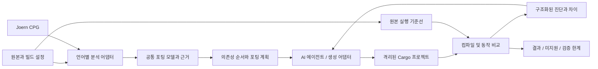

# Reforge-MCP: Rust 자동 포팅 설계

상태: 방향 확정 / 포팅 엔진 구현 전. 2026-10-12 기준.

## 목표와 자동화 모델

C, C++, Java, Python, Go 소스를 Rust 프로젝트로 이전하고, 자동화 가능한 범위에서는 분석·생성·검증·수정을 반복한다. 결과물은 빌드 가능한 Cargo 프로젝트, 원본과의 대응표, 재현 가능한 검증 기록, 미지원 항목이다.

MCP 서버는 분석과 검증을 실행하고 작업을 저장하는 조정 계층이다. 초기 생성 주체는 MCP 클라이언트의 AI 에이전트다. 에이전트는 원본 컨텍스트를 읽고 Rust 후보를 제출한다. 후속 단계에서 서버 내부 생성 어댑터를 추가하되 특정 모델 제공자에 제품 계약을 종속시키지 않는다. MCP 연결만으로 서버 내부 LLM 호출이 가능하다고 가정하지 않는다.

전체 언어의 임의 프로젝트를 한 번에 변환하는 것을 첫 버전의 완료 조건으로 삼지 않는다. 좁은 지원 범위를 명시하고 함수→모듈→프로젝트 순으로 확장한다. CLI/API 동작, 오류, 출력 형식과 부작용을 보존하는 것이 우선이며, 더 관용적인 Rust로의 개선은 동작 검증 후 별도 단계로 처리한다.

## 분석과 생성 구조

Joern 공식 문서는 C/C++, Java, Python, Go 프런트엔드를 나열한다. 실제 백엔드의 언어 지원·버전·분석 품질은 설치된 배포본과 fixture로 확인해야 한다. CPG는 분석 근거로 사용하며 Rust 생성기나 의미 동등성 증명으로 취급하지 않는다. 데이터 흐름 계층의 존재와 미해결 호출도 따로 기록한다.

- [Joern 언어 및 CPG 개요](https://docs.joern.io/)
- [그래프 내보내기와 데이터 흐름 계층](https://docs.joern.io/export/)
- [CPG 스키마](https://cpg.joern.io/)

초기 Joern 어댑터는 고정된 분석 스크립트와 CLI를 별도 프로세스로 실행한다. 그래프 전체를 프롬프트에 넣지 않고, 함수와 의존성 중심의 제한된 컨텍스트를 추출한다. 외부 프로세스는 argv 배열, 타임아웃, 종료 코드, 제한된 로그 및 아티팩트 경로를 기록한다. 프로세스 실행/그래프 파싱 실패 시 성공한 분석으로 진행하지 않는다. tree-sitter 검색은 보조 기능으로 유지하며 Joern 의미 분석과 같은 보장으로 보고하지 않는다.

## 공통 포팅 모델

CPG와 분리된 제품 모델을 두어 분석 백엔드를 교체할 수 있게 한다. 최소 데이터는 다음과 같다.

| 데이터 | 필수 내용 |
|---|---|
| 프로젝트 스냅샷 | 커밋 또는 파일 해시, 언어, 빌드 옵션, 의존성/런타임 버전 |
| 분석 근거 | 백엔드와 버전, 원본 파일/범위, 노드 식별자, 분석 누락 및 미해결 호출 |
| 포팅 단위 | 안정적인 unit_id, 함수/타입/모듈, 의존성과 SCC, 입력/출력 계약 |
| 의미 규칙 | 정수 폭·오버플로·문자열 인코딩·널/예외·소유권·별칭·부작용 |
| 후보 매핑 | 원본 unit_id와 Rust 파일/심볼, 생성 시도 번호, 후보 해시 |
| 검증 기록 | 실행 명령, 환경, fixture 해시, 종료 코드, 관찰 결과, 시간/리소스 제한 |

순환 의존성은 SCC 단위로 묶는다. 동적 호출이나 런타임 등록이 미해결이면 의존성 계획의 제한으로 표시한다. 원본 또는 후보가 변경되면 해당 검증과 영향받는 단위의 검증을 만료시킨다.

## 계획된 MCP 계약

아래 도구는 아직 구현되지 않았다. 현재 호출 가능한 제품 상태 도구는 `get_porting_capabilities`다.

| 도구 | 입력/결과 핵심 |
|---|---|
| `analyze_porting_project` | 원본 경로와 언어/빌드 설정 → 스냅샷, 분석 coverage, 미지원 목록 |
| `create_porting_plan` | 분석 ID와 목표/정책 → 의존성 순서, 검증 계약, 작업 목록 |
| `get_porting_context` | job_id와 unit_id → 원본 코드, 타입/호출, 의미 규칙, 테스트 계약 |
| `submit_rust_candidate` | job_id, unit_id, 후보 파일/내용 → 격리된 출력과 후보 해시 |
| `verify_port` | job_id와 후보 해시 → 컴파일 진단, 차등 테스트, evidence ID |
| `get_porting_report` | job_id → 상태, 대응표, 검증 범위, 미지원/실패/잔여 작업 |

에이전트는 컨텍스트 조회→후보 제출→검증→수정을 반복한다. 자동 재시도 횟수, 시간, 모델 비용 예산을 제한하고, 한도 도달은 `blocked` 또는 `failed`로 종료한다. 입력에 임의 셸 문자열을 허용하는 도구를 기본 계약으로 두지 않는다. 타깃 실행은 명시된 실행 환경과 리소스 제한 안에서 수행하며 원본 경로를 출력 경로로 사용하지 않는다.

## 상태와 검증

작업 상태는 `created → analyzed → planned → generating → verifying → completed`로 진행한다. `blocked`, `failed`, `cancelled` 상태도 유지한다. 현재 SQLite 목표/로드맵을 조정 계층으로 재사용하되, 포팅 전용 job/unit/attempt/evidence 테이블을 추가한다. 일반 로드맵의 `done`을 동작 검증 통과로 간주하지 않는다. 완료 전이는 최신 후보에 대한 필수 evidence로 제한한다.

컴파일 성공과 원본 동작 일치를 별도 결과로 저장한다. 동작 비교는 동일 fixture에서 반환값·표준 출력/오류·종료 코드·허용된 파일 부작용 등을 관찰한다. 시간, 난수, 순서, float 허용 오차는 계약에서 고정하거나 명시한다. 원본 빌드/실행이 불가능하면 `unverified`이며 완료로 표시하지 않는다. UB에 의존하는 C/C++ 동작은 이식 가능한 계약을 별도로 정하기 전까지 차단한다.

기존 테스트, 경계값, 생성 입력의 차등 테스트를 조합한다. fixture 통과는 그 검증 범위의 근거이며 전체 프로그램의 동등성 증명이 아니다. 원본의 취약하거나 의도하지 않은 동작을 바꾸는 수정도 포팅과 분리해 기록한다.

## 언어별 진행 순서와 제한

다섯 언어 모두 제품 목표로 유지하되 첫 수직 구현은 C→Rust로 시작한다. 정적으로 타입이 정해진 작은 함수에서 분석, 생성, 실행 비교가 이어지는지 검증하기 쉽다.

| 언어 | 초기 범위 | 확장 전 차단/명시 항목 |
|---|---|---|
| C | 고정 폭 정수, 분기/루프, 명시적 배열 길이의 함수 | 포인터 별칭/소유권, UB, 전처리/ABI, 함수 포인터 |
| C++ | 값 타입, 제한된 클래스/컨테이너 | 템플릿, 상속/가상 호출, RAII, 예외, ABI |
| Java | 정적 타입의 로직과 제한된 클래스 | reflection, 프레임워크, GC 별칭, 예외, JVM 라이브러리 |
| Python | 타입 계약이 있는 순수 함수와 작은 CLI | 동적 타입/속성, 큰 정수 의미, monkey patch, C 확장 |
| Go | 동기 함수, struct, 명시적 error | goroutine/channel, interface dispatch, defer/panic, 런타임 의미 |

`safe Rust`를 기본 목표로 한다. FFI/unsafe가 필요한 단위는 근거와 범위를 기록하고 정책에 따라 차단 또는 허용한다. 의존 라이브러리 대체는 API 이름뿐 아니라 오류/성능/라이선스/런타임 요구를 비교한다. 언어 간 정수·문자열·예외 차이는 생성 프롬프트에 맡기지 않고 단위별 계약에 남긴다.

## 단계별 인수 기준

| 단계 | 산출물 | 완료 기준 |
|---|---|---|
| 0. 제품 전환 | README, 설계, 실행 파일/서버 이름, 기능 조회 | 기존 데이터 유지, 실제 MCP 초기화와 기능 조회 성공 |
| 1. 분석 기반 | Joern 어댑터, 공통 모델, C fixture | 버전 고정, 원본 해시/범위/호출 매핑, 실패/누락 노출 |
| 2. C 수직 구현 | 계획·컨텍스트·후보·검증 도구 | 다중 함수 fixture의 원본/Rust 실행 비교, 실패 후보 거부, 재개 |
| 3. 프로젝트 포팅 | Cargo 생성, 모듈 매핑, 의존성 대체 | 실제 작은 C 프로젝트 포팅, 재현 스크립트, 차등 테스트, stale evidence 무효화 |
| 4. 언어 확장 | C++/Java/Python/Go 어댑터와 의미 규칙 | 각 언어별 실제 프로젝트와 미지원 회귀 fixture 통과 |
| 5. 자동 반복 | 생성 어댑터, 예산, 수정/재개 | 실패 진단을 받아 수정 후 재검증, 제한 종료, 독립 실행 재현 |

첫 benchmark는 지원 가능한 작은 fixture와 의도적으로 거부할 fixture를 함께 둔다. 이후 실제 프로젝트 corpus에서 분석 coverage, 빌드 성공률, 차등 테스트 통과율, 미지원 비율, unsafe 범위, 수행 시간/비용을 함께 보고한다. 실패/거부 항목을 분모에서 숨기지 않는다.

## 기존 코드와 이름 전환

- `fossil-repo`: 원본 스냅샷과 Git 작업 기반.
- `fossil-indexer`: 기존 소스 검색 기반. Joern 어댑터 및 포팅 모델은 별도 모듈/크레이트로 확장.
- `fossil-search`: 포팅 컨텍스트 탐색의 보조 기능.
- `fossil-core`: 기존 SQLite와 로드맵. 포팅 상태/근거 저장을 추가할 위치.
- `fossil-server`: `reforge-mcp` 실행 파일과 MCP 조정 계층.

실행 파일·MCP 제품 이름·릴리즈 아카이브를 먼저 전환한다. 내부 크레이트 이름, `FOSSIL_*` 환경변수, 저장 경로는 현재 유지한다. GitHub 저장소는 `sjkim1127/reforge-mcp`로 변경한다. 내부 이름/캐시 이전은 별도 호환성 변경으로 처리한다. 기존 문서는 `docs/fossil-reference.md`에 보존한다.
